# CHEMICAL ROMANCE 💘🧪
### Swipe right for chemistry. Fall in love with the periodic table.

<p align="center">
118 Elements. Infinite Personalities. Real Chemistry.
</p>

<p align="center">
  An interactive, character-driven chemistry learning game that transforms the periodic table into a world of discovery, relationships, experimentation, challenges and scientific exploration.
</p>

TODO:


Story-Based Linking (The First 10 Elements)

Create a vivid, wild mini-story in your head to link symbols and names together:
• H & He (Hydrogen & Helium): Wave Hi while holding a floating Helium balloon.
• Li & Be & B (Lithium, Beryllium, Boron): The balloon is powered by Lithium batteries, grabbed by a Bear standing on a Board.
• C, N, O (Carbon, Nitrogen, Oxygen): A Car drives by and the driver shakes their head No for Oxygen.
• F & Ne (Fluorine & Neon): They drive to a shop with a bright Neon sign selling Flooring (Fluorine).

2. Catchy Row Mnemonics

Break the table down into bite-sized sentence mnemonics (like acrostics):
• Row 2 (Li, Be, B, C, N, O, F, Ne): "Little Betty Bakes Cookies Not Only For Ned" or "Libebcnofne".
• Row 3 (Na, Mg, Al, Si, P, S, Cl, Ar): "Nancy Might Always Sing Perfect Songs Clearly"

---

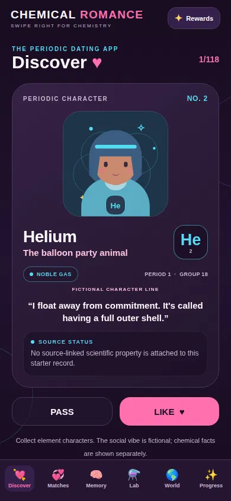 

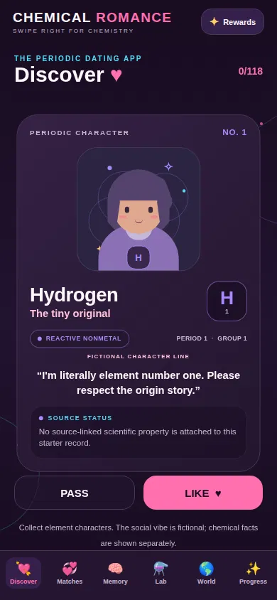 

.png?raw=true) 


# Table of Contents

1. [Introduction](#1-introduction)
2. [Vision and Product Philosophy](#2-vision-and-product-philosophy)
3. [Learning Objectives](#3-learning-objectives)
4. [Game Features](#4-game-features)
5. [Gameplay Architecture](#5-gameplay-architecture)
6. [Technical Architecture](#6-technical-architecture)
7. [Technology Stack](#7-technology-stack)
8. [Repository Structure](#8-repository-structure)
9. [Periodic Table Data Architecture](#9-periodic-table-data-architecture)
10. [Element Persona System](#10-element-persona-system)
11. [Discovery and Matching Engine](#11-discovery-and-matching-engine)
12. [Chemistry Laboratory Engine](#12-chemistry-laboratory-engine)
13. [AI and Adaptive Learning Roadmap](#13-ai-and-adaptive-learning-roadmap)
14. [Memory and Spaced Repetition](#14-memory-and-spaced-repetition)
15. [Gamification and Progression](#15-gamification-and-progression)
16. [Data Persistence and State Management](#16-data-persistence-and-state-management)
17. [UI/UX and Visual Design](#17-uiux-and-visual-design)
18. [Scientific Integrity and Validation](#18-scientific-integrity-and-validation)
19. [Testing, Installation and Development](#19-testing-installation-and-development)
20. [Roadmap and Future Development](#20-roadmap-and-future-development)

---

# 1. Introduction

## 1.1 What is CHEMICAL ROMANCE?

CHEMICAL ROMANCE is an educational mobile game that introduces chemistry through an unconventional interaction model inspired by social discovery and collectible character games.

The player explores the periodic table by meeting individual elements represented as distinctive characters.

Every element has a scientific identity and a fictional personality.

Players can:

- Discover elements through swipe-based gameplay.
- Learn atomic numbers and chemical symbols.
- Explore periodic families and classifications.
- Collect element characters.
- Complete chemistry quizzes.
- Build selected chemical formulas.
- Complete daily and weekly challenges.
- Unlock achievements and cosmetic rewards.
- Develop long-term knowledge through repeated review.

The game combines educational science, character design, memory mechanics and interactive progression.

## 1.2 The central concept

Traditional chemistry learning often introduces the periodic table as a large reference chart containing 118 elements.

CHEMICAL ROMANCE transforms that experience into an interactive collection.

Instead of memorizing a disconnected list, players encounter elements individually and gradually develop familiarity with their identities, properties and relationships.

The central gameplay metaphor is:

**Meet an element. Learn its identity. Remember its chemistry. Build your collection.**

## 1.3 Product objectives

| Objective | Description |
|---|---|
| Memorization | Help players remember all 118 elements |
| Recognition | Connect element names, symbols and atomic numbers |
| Understanding | Explain periodic families and scientific patterns |
| Engagement | Use character personalities and discovery mechanics |
| Retention | Reinforce learning through spaced repetition |
| Experimentation | Introduce curated chemical formulas |
| Progression | Reward consistent learning and improvement |

## 1.4 Core experience

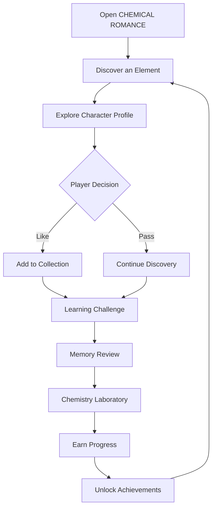

## 1.5 Educational positioning

The game is designed as an educational supplement, not a replacement for chemistry instruction, textbooks or laboratory education.

Its primary focus is introductory periodic-table literacy and the gradual development of chemistry knowledge.

---

# 2. Vision and Product Philosophy

## 2.1 Vision

Make chemistry memorable by turning the periodic table into a world players want to explore.

The goal is to create an educational experience where scientific learning feels like discovery rather than memorization alone.

## 2.2 Design philosophy

CHEMICAL ROMANCE follows five principles.

### 1. Science first

Scientific facts must remain accurate even when character personalities are humorous or exaggerated.

### 2. Personality creates memory

Characters should have recognizable personalities, visual identities and memorable educational hooks.

### 3. Learning creates progression

Rewards should encourage players to remember and understand chemistry rather than simply tap through cards.

### 4. Exploration should be rewarding

Players should gradually uncover the periodic table through discovery, challenges and collection.

### 5. Chemistry and fiction must remain separate

The dating-app metaphor is fictional.

A fictional social compatibility score must never be presented as a scientific prediction of chemical bonding or reactivity.

## 2.3 Product pillars

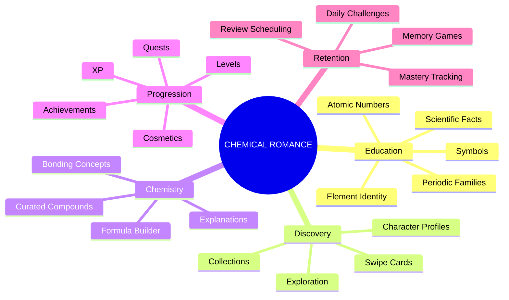

---

# 3. Learning Objectives

The educational system is built around active recall, repeated exposure and progressively more difficult questions.

## 3.1 Core knowledge categories

Players should gradually learn:

| Knowledge category | Example |
|---|---|
| Element name | Oxygen |
| Chemical symbol | O |
| Atomic number | 8 |
| Group | 16 |
| Period | 2 |
| Block | p-block |
| Family | Chalcogen family |
| Classification | Nonmetal |
| Scientific properties | Physical and chemical properties |
| Applications | Biological and industrial applications |

## 3.2 Six foundational mastery dimensions

The current player progress model supports six independently tracked learning skills:

1. Name recognition.
2. Symbol recognition.
3. Atomic-number recall.
4. Group identification.
5. Period identification.
6. Family identification.

Each skill should maintain independent statistics.

For example, a player may know that oxygen has the symbol O but still struggle to remember its atomic number.

These should be treated as different learning outcomes.

## 3.3 Learning progression

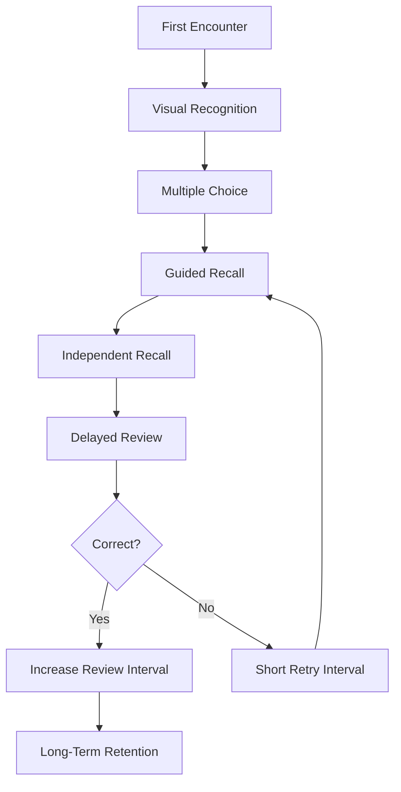

## 3.4 Knowledge progression levels

| Level | Learning ability |
|---|---|
| 1 | Recognizes the character |
| 2 | Recognizes the element name |
| 3 | Remembers the chemical symbol |
| 4 | Remembers the atomic number |
| 5 | Identifies its periodic family |
| 6 | Understands its periodic position |
| 7 | Explains selected scientific properties |
| 8 | Applies knowledge in chemistry challenges |

## 3.5 Educational philosophy

The player should not become a chemistry expert simply because they have collected 118 characters.

Collection completion and chemistry mastery are separate achievements.

---

# 4. Game Features

## 4.1 Discover

The Discover screen is the primary interaction area.

Players encounter element cards and choose whether to like or pass.

Each card should display:

- Element character artwork.
- Element name.
- Chemical symbol.
- Atomic number.
- Periodic family.
- Short personality description.
- Scientific fact.
- Memory hook.

## 4.2 Matches

The Matches section displays elements the player has liked.

Potential future functionality includes:

- Collection sorting.
- Element profile pages.
- Family collections.
- Completion percentages.
- Character dialogue.
- Collection achievements.

## 4.3 Memory

The Memory section introduces retrieval-based learning.

Potential question formats include:

- Identify the element from its symbol.
- Identify the symbol from its name.
- Identify the atomic number.
- Identify the element family.
- Identify the period.
- Reconstruct the periodic table.

## 4.4 Laboratory

The Chemistry Lab provides curated educational formula-building challenges.

Players select elements and attempt to reproduce a supported formula.

The application compares their selection against predefined educational scenarios.

It does not predict arbitrary chemical reactions.

## 4.5 Periodic World

The Periodic World section allows players to explore the full element dataset.

Potential filters:

- Atomic number.
- Element name.
- Symbol.
- Group.
- Period.
- Block.
- Family.
- Classification.

## 4.6 Progress

The Progress section tracks player activity and educational development.

Metrics can include:

- Elements discovered.
- Elements liked.
- Questions answered.
- Correct answers.
- Learning streak.
- XP.
- Player level.
- Review completion.
- Family mastery.

## 4.7 Gamification screens

The expanded gamification subsystem introduces:

| Screen | Purpose |
|---|---|
| Gamification Dashboard | Overall player progression |
| Quest Board | Daily, weekly and story quests |
| Badge Gallery | Achievement collection |
| Shop | Cosmetic purchases and equipment |

---

# 5. Gameplay Architecture

## 5.1 Main game loop

The main gameplay loop combines exploration and educational reinforcement.

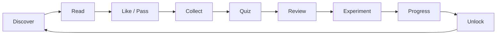

## 5.2 Discovery loop

The discovery loop should be simple enough for new players.

1. Present an undiscovered element.
2. Display its identity and character.
3. Let the player explore the profile.
4. Accept a like or pass decision.
5. Record discovery.
6. Update player progress.
7. Move to the next element.

## 5.3 Session lifecycle

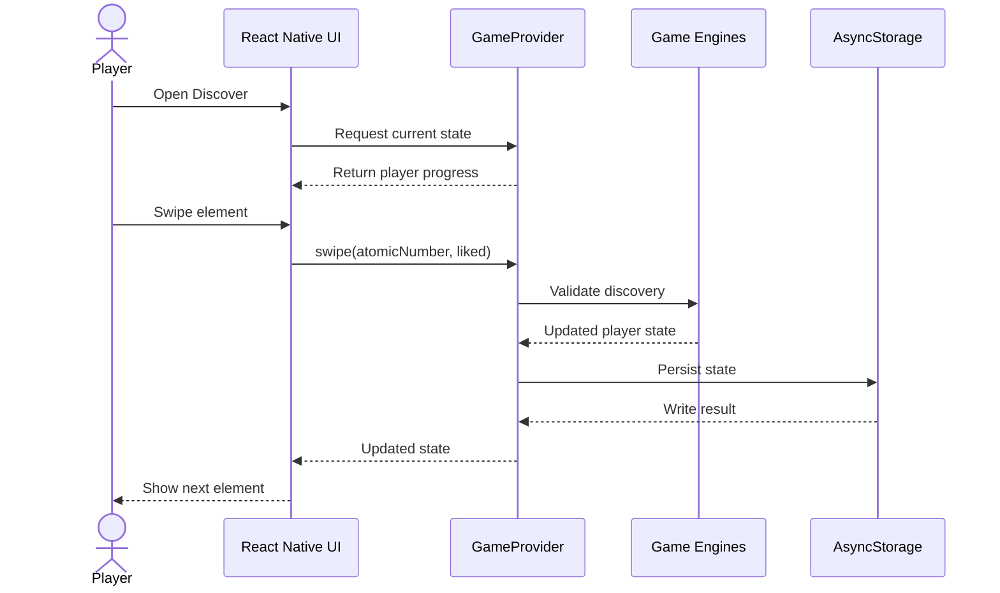

## 5.4 Gameplay requirements

Every major interaction should have:

- A loading state.
- A success state.
- An error state.
- A duplicate-action safeguard.
- A persistence strategy.
- Accessible feedback.
- A predictable state transition.

---

# 6. Technical Architecture

## 6.1 Architectural overview

CHEMICAL ROMANCE uses a layered application architecture.

The presentation layer handles interaction and visual rendering.

The state layer coordinates application data.

The domain layer contains chemistry, discovery, learning and reward logic.

The data layer provides element records, challenge content and local persistence.

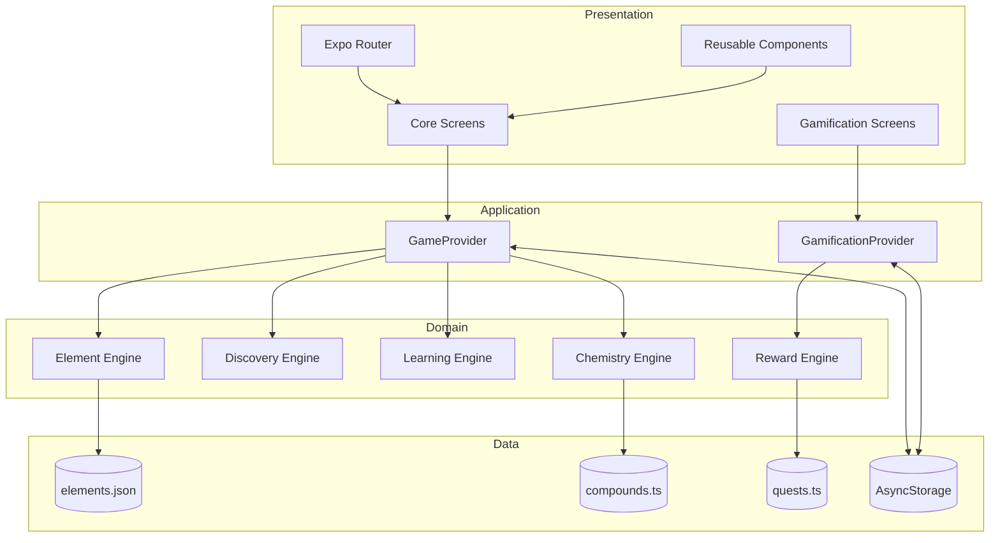

## 6.2 Architectural responsibilities

### Presentation layer

Responsibilities:

- Render game screens.
- Display element characters.
- Handle gestures.
- Show animations.
- Display educational explanations.
- Handle navigation.

### Application state layer

Responsibilities:

- Manage player progress.
- Coordinate domain actions.
- Load persisted state.
- Save updated state.
- Expose typed application actions.

### Domain layer

Responsibilities:

- Validate element identities.
- Calculate discovery outcomes.
- Validate supported formulas.
- Calculate review schedules.
- Calculate XP and progression.
- Evaluate quest conditions.
- Validate cosmetic transactions.

### Data layer

Responsibilities:

- Store canonical element records.
- Store curated chemistry scenarios.
- Store learning content.
- Persist player progress.

## 6.3 Architectural rules

- Keep chemistry rules outside screen components.
- Keep element identity data centralized.
- Avoid duplicated reward calculations.
- Use explicit TypeScript interfaces.
- Validate input before applying state changes.
- Keep social compatibility separate from chemical compatibility.
- Make domain engines independently testable.

---

# 7. Technology Stack

## 7.1 Core stack

| Technology | Responsibility |
|---|---|
| Expo SDK 54 | Mobile application framework |
| React Native 0.81.5 | Cross-platform interface |
| React 19.1 | Component architecture |
| TypeScript 5.9 | Static typing |
| Expo Router 6 | File-based navigation |
| AsyncStorage 2.2 | Local persistence |
| React Native Gesture Handler | Gesture handling |
| Reanimated 4 | Animation |
| Expo Haptics | Haptic feedback |
| Expo Speech | Speech capabilities |
| Expo Linear Gradient | Gradient visuals |
| Lucide React Native | Icons |
| Jest 29 | Testing |
| jest-expo | Expo test environment |

## 7.2 Why Expo?

Expo provides a streamlined environment for React Native development.

It supports:

- iOS development.
- Android development.
- Web previews.
- Native module integration.
- Development builds.
- App Store deployment workflows.

## 7.3 Why TypeScript?

TypeScript improves reliability by defining explicit contracts for:

- Elements.
- Player progress.
- Quiz questions.
- Chemistry scenarios.
- Game events.
- Rewards.
- Quests.
- Inventory.

## 7.4 Why local-first architecture?

The current foundation uses local persistence.

This means the core experience does not require an online account or cloud service.

Future cloud services can be introduced behind repository interfaces without replacing the learning engines.

---

# 8. Repository Structure

```text
chemical-romance/
│
├── app/
│   ├── _layout.tsx
│   ├── index.tsx
│   ├── gamification.tsx
│   ├── quests.tsx
│   ├── badges.tsx
│   └── shop.tsx
│
├── assets/
│   ├── images/
│   ├── characters/
│   ├── icons/
│   └── animations/
│
├── docs/
│   ├── ART_DIRECTION.md
│   ├── CONTENT_AUTHORING_TEMPLATE.md
│   ├── GAME_DESIGN.md
│   ├── REPLIT_PROMPT.md
│   ├── REPLIT_SETUP.md
│   └── SCIENCE_POLICY.md
│
├── src/
│   │
│   ├── components/
│   │
│   ├── data/
│   │   ├── elements.json
│   │   ├── compounds.ts
│   │   ├── characterDialogue.ts
│   │   ├── elementFamilies.ts
│   │   ├── firstTwentyLessons.ts
│   │   └── quests.ts
│   │
│   ├── engine/
│   │   ├── services/
│   │   ├── micro/
│   │   ├── elementEngine.ts
│   │   ├── discoveryEngine.ts
│   │   ├── matchingEngine.ts
│   │   ├── chemistryEngine.ts
│   │   ├── reviewEngine.ts
│   │   └── validation.ts
│   │
│   ├── gamification/
│   │   ├── components/
│   │   ├── screens/
│   │   ├── engines/
│   │   ├── data/
│   │   └── types/
│   │
│   ├── hooks/
│   ├── screens/
│   ├── store/
│   ├── theme/
│   └── types/
│
├── tests/
│   ├── chemistry.test.ts
│   ├── dataset.test.ts
│   └── gamification.test.ts
│
├── package.json
├── tsconfig.json
└── README.md
```

## 8.1 Folder responsibilities

| Folder | Responsibility |
|---|---|
| `app/` | Expo Router entry points |
| `assets/` | Images, artwork and visual resources |
| `docs/` | Product and technical documentation |
| `src/components/` | Reusable UI components |
| `src/data/` | Element and educational datasets |
| `src/engine/` | Core domain logic |
| `src/gamification/` | Rewards and progression |
| `src/screens/` | Main game screens |
| `src/store/` | Application state providers |
| `src/theme/` | Design tokens |
| `src/types/` | Shared TypeScript contracts |
| `tests/` | Automated tests |

---

# 9. Periodic Table Data Architecture

## 9.1 The 118-element dataset

The periodic table is the central educational dataset.

Every element is represented by a canonical record.

The dataset must maintain one record for each atomic number from 1 through 118.

## 9.2 Element schema

```typescript
export type ElementBlock = "s" | "p" | "d" | "f";

export interface ElementCharacter {
  atomicNumber: number;

  name: string;

  symbol: string;

  group: number | null;

  period: number;

  block: ElementBlock;

  family: string;

  category: string;

  personalityTitle: string;

  memoryHook: string;

  bio: string;

  tagline: string;

  signatureFact: string;

  realWorldUses: string[];

  isDataVerified: boolean;
}
```

## 9.3 Example: Oxygen

```json
{
  "atomicNumber": 8,
  "name": "Oxygen",
  "symbol": "O",
  "group": 16,
  "period": 2,
  "block": "p",
  "family": "nonmetal",
  "category": "reactive nonmetal",
  "personalityTitle": "The Life Support",
  "memoryHook": "Oxygen is element number eight.",
  "bio": "A memorable character introduction.",
  "tagline": "A short fictional character line.",
  "signatureFact": "A scientifically reviewed fact.",
  "realWorldUses": [],
  "isDataVerified": false
}
```

This illustrates the record structure. Individual scientific and persona fields require editorial verification before being treated as production-ready educational content.

## 9.4 Dataset architecture

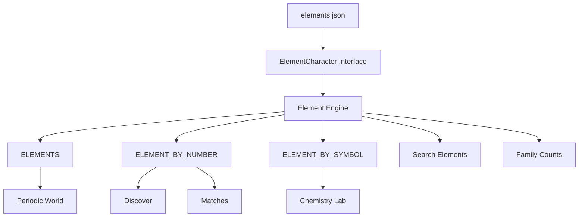

## 9.5 Element engine functionality

The element engine provides lookup and search functionality.

Expected functions include:

```typescript
getElement(atomicNumber);

searchElements(query);

getNextUndiscovered(discoveredElements);

getFamilyCounts();
```

The actual implementation should remain the source of truth for function signatures.

## 9.6 Dataset validation

The validation engine should check:

- Total record count.
- Atomic-number uniqueness.
- Symbol uniqueness.
- Required identity fields.
- Valid periodic-table block values.
- Valid period values.
- Group representation.
- Family classification consistency.
- Required persona fields.
- Scientific verification status.

## 9.7 Data quality pipeline

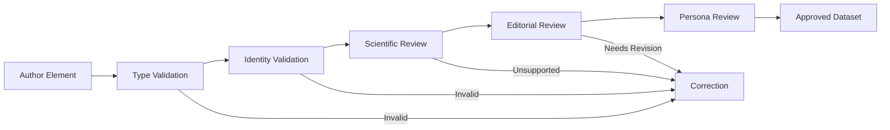

A production dataset should eventually include scientific source references, review dates, reviewer information and dataset version metadata.

---

# 10. Element Persona System

## 10.1 Character-driven learning

Each element is represented through a fictional personality.

The purpose is to make the element easier to recognize and remember.

The character should reflect a real property, use, classification or scientific association.

## 10.2 Character design dimensions

Each character should have:

| Dimension | Description |
|---|---|
| Identity | Element name and symbol |
| Personality | Fictional behavioral theme |
| Appearance | Original character illustration |
| Color palette | Consistent visual identity |
| Memory hook | Educational association |
| Signature fact | Scientific information |
| Dialogue | Character-based educational copy |
| Family | Periodic classification |

## 10.3 Personality-to-science relationship

Character design should be inspired by science without replacing science.

For example:

- Noble gases may inspire independent character archetypes because of their low chemical reactivity under ordinary conditions.
- Alkali metals may inspire energetic personalities because of their characteristic reactivity.
- Halogens may inspire intense or highly interactive character designs because of their chemistry.
- Transition metals may inspire versatile personalities because of their varied oxidation states and coordination chemistry.

These are artistic metaphors, not literal descriptions of human personalities.

## 10.4 Character content architecture

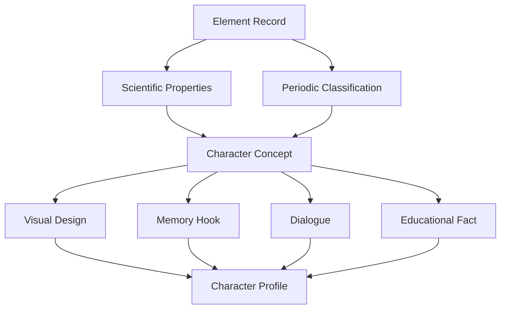

## 10.5 Content requirements

Every character should have:

- A unique identity.
- A distinctive visual concept.
- A short educational introduction.
- A scientifically grounded memory hook.
- One reviewed scientific fact.
- A consistent relationship to its periodic classification.

---

# 11. Discovery and Matching Engine

## 11.1 Discovery mechanics

The discovery engine controls which element is presented to the player and how player decisions affect progress.

## 11.2 Player state

The core player state includes:

```typescript
export interface PlayerState {
  version: number;

  xp: number;

  coins: number;

  streak: number;

  lastPlayedDate: string | null;

  swiped: number[];

  liked: number[];

  matches: number[];

  progress: Record<number, ElementProgress>;

  completedChallenges: string[];

  soundEnabled: boolean;
}
```

## 11.3 Swipe mechanics

A player can:

- Like an element.
- Pass on an element.

Both actions record discovery.

A like additionally adds the element to the player's liked collection.

## 11.4 Swipe state flow

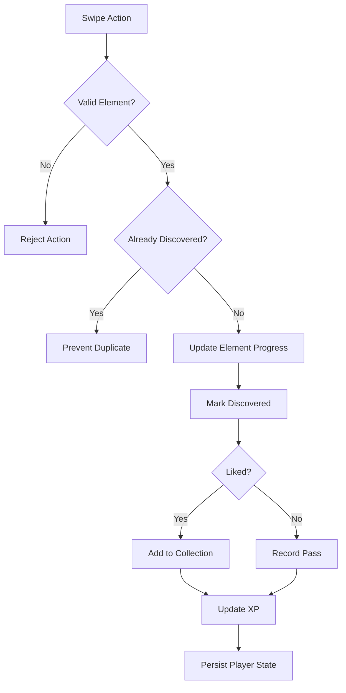

## 11.5 Matching engine

The matching engine can calculate fictional social-style compatibility.

Possible inputs:

- Character archetypes.
- Narrative themes.
- Personality tags.
- Story relationships.
- Educational categories.

However, this system must remain separate from scientific chemistry.

A fictional match does not establish that two elements form a stable compound.

## 11.6 Matching output

A future structured matching result could look like:

```typescript
interface SocialMatchResult {
  elementA: number;

  elementB: number;

  score: number;

  label: string;

  explanation: string;

  isFictional: true;
}
```

## 11.7 Collection progression

Potential future collection features:

- Periodic-family completion.
- Block completion.
- Period completion.
- Collection badges.
- Character profile unlocks.
- Alternate artwork.
- Collection statistics.

---

# 12. Chemistry Laboratory Engine

## 12.1 Purpose

The Chemistry Lab introduces formula construction through curated scientific examples.

Players select elements and attempt to build a supported formula.

The current system is a deterministic educational challenge engine.

It is not a general-purpose chemical reaction predictor.

## 12.2 Supported starter scenarios

The starter dataset includes examples such as:

| Formula | Name | Elements |
|---|---|---|
| H₂O | Water | Hydrogen and oxygen |
| CO₂ | Carbon dioxide | Carbon and oxygen |
| NaCl | Sodium chloride | Sodium and chlorine |
| NH₃ | Ammonia | Nitrogen and hydrogen |
| MgO | Magnesium oxide | Magnesium and oxygen |
| KBr | Potassium bromide | Potassium and bromine |
| SiO₂ | Silicon dioxide | Silicon and oxygen |

## 12.3 Formula validation

The validation process:

1. Receives selected atomic numbers.
2. Normalizes the selected list.
3. Loads the curated scenario dataset.
4. Expands the expected atomic-number list using stoichiometric ratios.
5. Compares the normalized lists.
6. Returns a structured result.
7. Displays the relevant educational explanation.

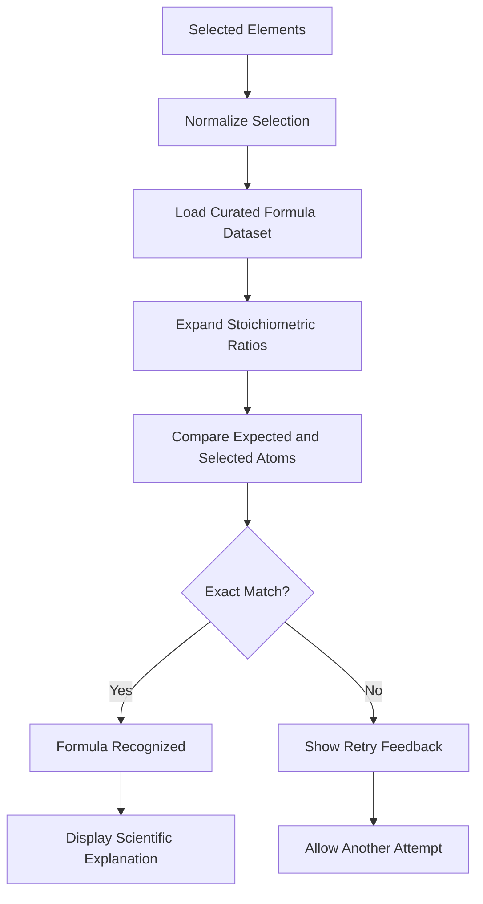

## 12.4 Example: Water

```text
Element 1: Hydrogen
Atomic number: 1

Element 2: Hydrogen
Atomic number: 1

Element 3: Oxygen
Atomic number: 8

Expected ratio: 2 : 1

Formula: H₂O
```

## 12.5 Example: Sodium chloride

```text
Sodium:
Atomic number 11

Chlorine:
Atomic number 17

Expected ratio:
1 : 1

Formula:
NaCl
```

Sodium chloride is an ionic solid. Its formula represents a formula unit and the ratio of ions in an extended crystal lattice, rather than a discrete molecule.

## 12.6 Formula data contract

A future expanded scenario interface could use:

```typescript
interface CompoundScenario {
  id: string;

  name: string;

  formula: string;

  components: {
    atomicNumber: number;
    ratio: number;
  }[];

  classification: string;

  explanation: string;

  difficulty: number;
}
```

## 12.7 Scientific limitations

- Only curated scenarios are supported.
- An unsupported formula is not automatically chemically impossible.
- Formula validation is not reaction prediction.
- Formula construction does not simulate reaction conditions.
- Ionic and molecular substances must be explained correctly.
- Extended network solids must not be described as isolated small molecules.

## 12.8 Future laboratory features

- Bond-type learning.
- Molecular geometry lessons.
- Periodic trends challenges.
- Stoichiometry exercises.
- Formula balancing.
- Chemical nomenclature.
- Interactive atomic structure.
- Electron configuration learning.

---

# 13. AI and Adaptive Learning Roadmap

## 13.1 AI direction

Future versions can introduce AI-assisted learning while keeping verified scientific content as the source of truth.

AI should explain and personalize learning, not invent unsupported chemistry.

## 13.2 Proposed AI tutor

The AI Chemistry Tutor could support:

- Explaining element properties.
- Answering questions about periodic families.
- Providing memory techniques.
- Generating practice questions from approved content.
- Explaining why an answer is incorrect.
- Adjusting explanation difficulty.
- Helping players understand chemistry vocabulary.

## 13.3 Proposed architecture

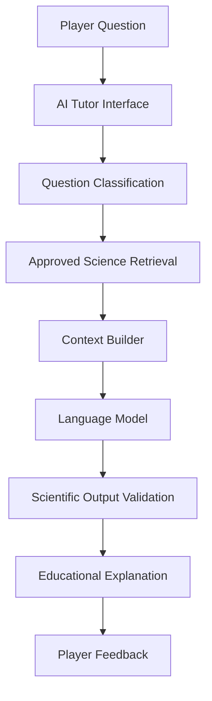

## 13.4 Retrieval-augmented generation

A future AI tutor could use retrieval-augmented generation.

The retrieval source should contain reviewed chemistry materials.

Possible sources:

- Curated element records.
- Approved lesson content.
- Verified formula scenarios.
- Educational reference documents.
- Teacher-reviewed explanations.

The model should be instructed to distinguish known facts from uncertainty.

## 13.5 Adaptive learning

A future adaptive system could consider:

- Correct-answer rate.
- Incorrect-answer patterns.
- Time since last review.
- Skill-specific mastery.
- Player-selected difficulty.
- Confidence ratings.

Example:

```typescript
interface LearningRecommendation {
  atomicNumber: number;

  skill: string;

  difficulty: number;

  reason: string;

  recommendedActivity: string;
}
```

## 13.6 AI safety requirements

- AI-generated facts must be checked against approved sources.
- Do not let an AI model modify canonical element identity.
- Clearly label AI-generated explanations.
- Do not present speculative chemistry as established science.
- Avoid unsafe experimental procedures.
- Provide a fallback when the model is unavailable.
- Keep core learning functionality available offline.

**Implementation status:** AI tutor, remote retrieval and adaptive model services are future development directions, not assumed to be implemented in the current foundation.

---

# 14. Memory and Spaced Repetition

## 14.1 Learning retention

The Memory system is designed to help players remember information beyond the first encounter.

Repeated recognition alone is not sufficient.

Players should be asked to recall information independently.

## 14.2 Skill tracking

Each element has independent progress for six skills:

```typescript
type MasterySkill =
  | "name"
  | "symbol"
  | "atomicNumber"
  | "group"
  | "period"
  | "family";
```

## 14.3 Skill statistics

```typescript
interface SkillStats {
  attempts: number;

  correct: number;

  streak: number;

  ease: number;

  intervalDays: number;

  dueAt: string;
}
```

## 14.4 Review scheduling

The starter review engine uses a simple deterministic scheduling policy.

| Answer result | Scheduling behavior |
|---|---|
| Incorrect | Reset streak and schedule a short retry |
| First consecutive correct answer | Approximately one day |
| Second consecutive correct answer | Approximately three days |
| Subsequent correct answers | Increase interval using the ease factor |

The current incorrect-answer retry is scheduled for approximately ten minutes.

This is a lightweight educational scheduling system, not a validated implementation of a specific scientific memory model.

## 14.5 Review architecture

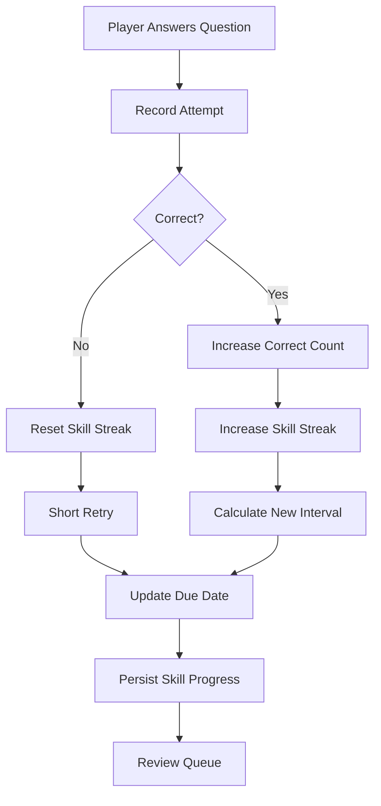

## 14.6 Future learning modes

- Flashcards.
- Timed quizzes.
- Untimed quizzes.
- Symbol recognition.
- Atomic-number recall.
- Periodic-family matching.
- Blank periodic-table reconstruction.
- Element comparison.
- Scientific fact recall.
- Challenge rounds.

---

# 15. Gamification and Progression

## 15.1 Purpose

Gamification adds motivation and gives players visible progress.

The gamification subsystem is separated from the core learning state.

## 15.2 Gamification systems

| System | Description |
|---|---|
| XP | Reward progression |
| Levels | Represent player advancement |
| Quests | Provide structured goals |
| Badges | Recognize achievements |
| Streaks | Encourage regular learning |
| Streak freezes | Provide recovery mechanics |
| Coins | Support cosmetic purchases |
| Inventory | Track unlocked items |
| Cosmetics | Customize the player profile |
| Seasonal events | Offer time-limited challenges |
| Weekly summaries | Show activity and progress |

## 15.3 Gamification architecture

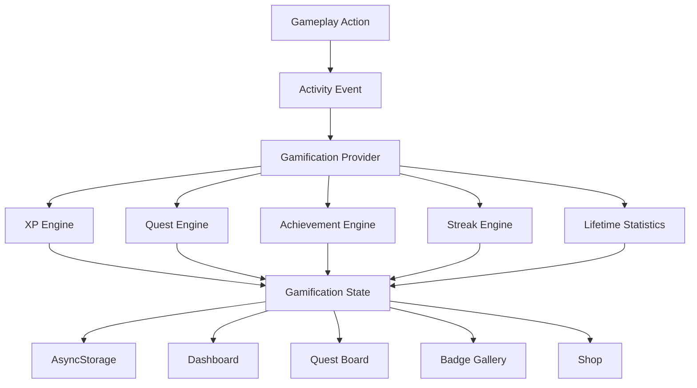

## 15.4 Gamification state

```typescript
interface GamificationState {
  schemaVersion: number;

  totalXp: number;

  wallet: CurrencyWallet;

  streak: StreakInfo;

  quests: Record<string, QuestProgress>;

  badges: PlayerBadge[];

  inventory: string[];

  equipped: Record<string, string | null>;

  activity: GameActivity[];

  dailyClaimedAt: string | null;

  weeklyClaimedAt: string | null;

  lifetime: Record<string, number>;

  updatedAt: string;
}
```

## 15.5 Activity event architecture

Potential activity events include:

```typescript
type GameActivityType =
  | "element_discovered"
  | "element_liked"
  | "element_matched"
  | "quiz_correct"
  | "quiz_wrong"
  | "formula_built"
  | "lesson_completed"
  | "daily_challenge_completed"
  | "review_completed"
  | "streak_day"
  | "collection_completed"
  | "boss_defeated"
  | "perfect_round";
```

The exact event contract should follow the actual TypeScript definitions in the repository.

## 15.6 Quest architecture

Quests can be categorized as:

- Daily quests.
- Weekly quests.
- Story quests.
- Discovery quests.
- Collection quests.
- Learning quests.
- Mastery quests.
- Challenge quests.

## 15.7 Quest lifecycle

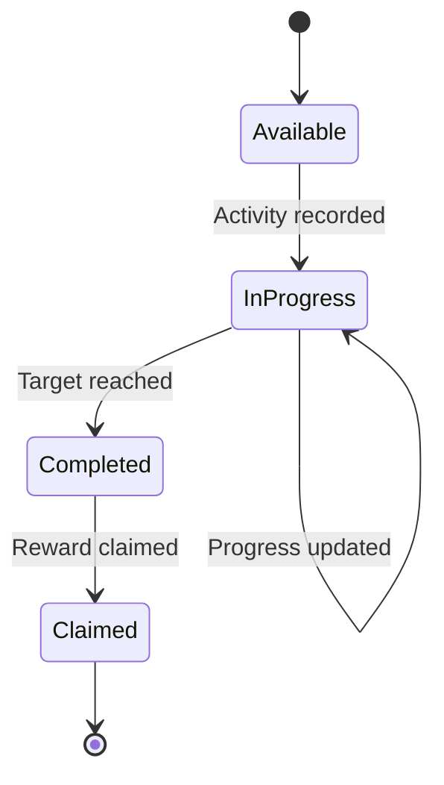

## 15.8 Achievement system

Achievement examples:

| Achievement | Condition |
|---|---|
| First Spark | Discover the first element |
| First Match | Like an element |
| Hydrogen Hello | Complete an introductory hydrogen lesson |
| Period Explorer | Discover a defined period collection |
| Family Collector | Complete a family collection |
| Memory Master | Reach a defined recall milestone |
| Lab Explorer | Complete a curated formula challenge |
| Perfect Round | Answer every question in a round correctly |

Achievement conditions should be explicit, deterministic and tested.

## 15.9 Economy and cosmetics

Potential cosmetic rewards:

- Character card frames.
- Profile backgrounds.
- Stickers.
- Player titles.
- Color themes.
- Celebration effects.

Cosmetics should not provide educational advantages or lock essential chemistry learning behind purchases.

## 15.10 Important integration note

The expanded gamification provider and routes exist as a separate subsystem.

The remaining integration task is to connect accepted core gameplay actions to the gamification activity API.

For example, an accepted discovery should create one discovery event.

The integration must prevent:

- Duplicate events.
- Duplicate XP.
- Rewards from rejected actions.
- Rewards triggered by React rendering.
- Multiple reward claims for one quest.

---

# 16. Data Persistence and State Management

## 16.1 Local persistence

The current foundation uses AsyncStorage.

Two independent state stores are maintained:

| State | Storage key |
|---|---|
| Core player state | `@chemical-romance/player-v1` |
| Gamification state | `@chemical-romance/gamification-v1` |

## 16.2 State architecture

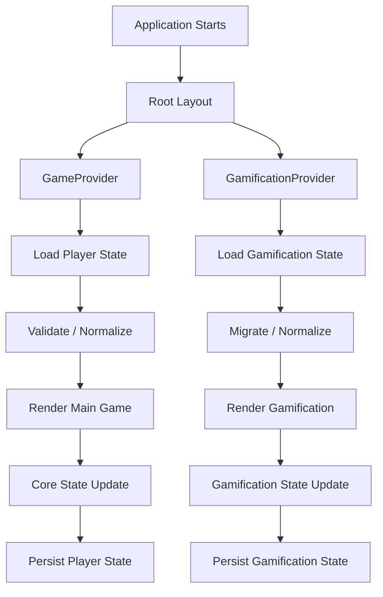

## 16.3 Core provider

The core `GameProvider` is responsible for:

- Initial state.
- Loading persisted player data.
- Updating discovery progress.
- Recording quiz answers.
- Awarding core progression.
- Resetting player state.
- Saving changes.

## 16.4 Gamification provider

The gamification provider manages:

- XP.
- Wallet.
- Quests.
- Badges.
- Streaks.
- Inventory.
- Equipped cosmetics.
- Activity history.
- Reward claims.

## 16.5 Data migration

Future state schema changes should use explicit migrations.

Recommended migration process:

1. Identify the previous schema version.
2. Read the stored record.
3. Validate its structure.
4. Apply the correct migration.
5. Preserve valid player progress.
6. Fill missing optional fields.
7. Persist the migrated schema.
8. Test both successful and failed migrations.

## 16.6 Persistence improvements

Future improvements should include:

- Better write-error handling.
- Corrupt-state recovery.
- Data export.
- Data import.
- Reset confirmation.
- Migration tests.
- Storage performance profiling.
- Optional cloud synchronization.

---

# 17. UI/UX and Visual Design

## 17.1 Visual direction

CHEMICAL ROMANCE uses a colorful, expressive visual identity.

The design direction combines:

- Cute anime-inspired character presentation.
- Modern mobile-game interfaces.
- Collectible card design.
- Chemistry-inspired visual elements.
- Premium typography.
- Smooth but restrained motion.

## 17.2 Visual personality

The game should feel:

- Playful.
- Memorable.
- Colorful.
- Friendly.
- Modern.
- Scientifically credible.

The visual design should avoid looking like a generic chemistry textbook.

## 17.3 Color direction

The existing design direction uses:

| Color family | Purpose |
|---|---|
| Deep plum | Background |
| Near-black | Primary dark surfaces |
| Pink | Primary accent |
| Violet | Secondary accent |
| Cyan | Scientific and interactive highlights |
| Gold | Rewards and milestones |
| White | Primary readable text |

## 17.4 UI architecture

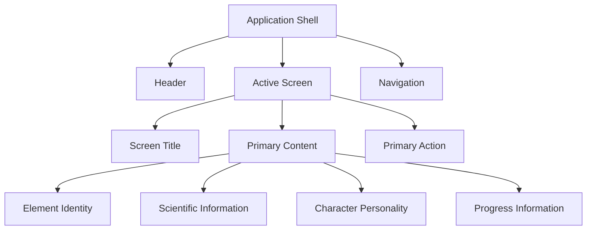

## 17.5 Element card design

Each element card should prioritize:

1. Character artwork.
2. Atomic number.
3. Chemical symbol.
4. Element name.
5. Family label.
6. Short character description.
7. Educational memory hook.

## 17.6 Animation

Suggested animations:

- Card swipe transitions.
- Character entrance effects.
- Match celebrations.
- XP progression.
- Achievement unlocks.
- Collection milestones.
- Quiz feedback.
- Lab success effects.

Motion should communicate meaning and remain optional where possible.

## 17.7 Accessibility

The interface should support:

- Screen-reader labels.
- Accessible touch targets.
- High-contrast text.
- Dynamic text sizing.
- Reduced-motion preferences.
- Color-independent feedback.
- Keyboard navigation on web.
- Accessible quiz controls.
- Non-audio feedback.
- Optional haptics.

---

# 18. Scientific Integrity and Validation

## 18.1 Science-first design

The fictional character layer must never compromise chemistry accuracy.

The game should be fun without teaching incorrect science.

## 18.2 Core scientific rules

1. Atomic numbers must match the correct element.
2. Chemical symbols must use correct capitalization.
3. Element names must be correctly spelled.
4. Group and period information must be reviewed.
5. Block classification must be consistent.
6. Family labels must be appropriate.
7. Formula ratios must be correct.
8. Ionic compounds must be described correctly.
9. Unmodelled chemistry must not be described as impossible.
10. Scientific facts must have reliable sources.
11. AI-generated explanations must be reviewed or grounded in approved references.
12. Fictional social compatibility must never be confused with chemical bonding.

## 18.3 Two independent relationship systems

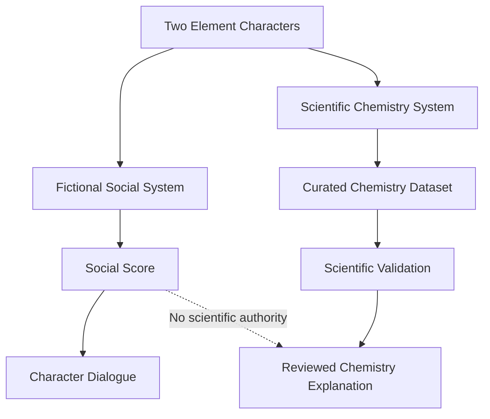

## 18.4 Scientific content workflow

Every scientific record should eventually include:

- Source reference.
- Verification date.
- Reviewer.
- Content version.
- Relevant scientific caveats.
- Review status.

## 18.5 Suggested authoritative references

The scientific editorial process should prioritize reliable institutional and scientific references, such as:

- [IUPAC](https://iupac.org/) — chemical nomenclature and terminology.
- [NIST](https://www.nist.gov/) — scientific reference data.
- [Royal Society of Chemistry](https://www.rsc.org/) — element information and chemistry education.
- [PubChem](https://pubchem.ncbi.nlm.nih.gov/) — chemical substance reference information.
- [Periodic Table of Elements](https://iupac.org/what-we-do/periodic-table-of-elements/) — IUPAC periodic-table resources.

Each claim should be checked against a suitable source rather than relying on a general website citation for an entire element profile.

## 18.6 Content safety

The Chemistry Lab is a conceptual educational tool.

It should not provide hazardous experimental recipes, unsafe handling instructions or actionable instructions for dangerous reactions.

---

# 19. Testing, Installation and Development

## 19.1 Prerequisites

- Node.js compatible with the configured Expo SDK.
- npm.
- Replit or a local development environment.
- Expo Go, simulator or development build for device testing.

## 19.2 Installation

Clone the repository:

```bash
git clone https://github.com/lucylow/chemical-romance.git

cd chemical-romance
```

Install dependencies:

```bash
npm install
```

Start Expo:

```bash
npm run start
```

## 19.3 Replit development

For a Replit environment:

```bash
npm install

npm run start -- --tunnel
```

Open the Expo development URL or QR code using a compatible device.

## 19.4 Platform commands

```bash
npm run ios

npm run android

npm run web
```

These commands depend on the development environment and configured package scripts.

Native-only behavior must be tested on a device or simulator.

## 19.5 Type checking

```bash
npm run typecheck
```

## 19.6 Tests

```bash
npm test -- --runInBand
```

## 19.7 Current test areas

| Test | Purpose |
|---|---|
| `chemistry.test.ts` | Curated formula validation and review behavior |
| `dataset.test.ts` | Element dataset integrity |
| `gamification.test.ts` | XP, quests, progression and economy logic |

## 19.8 Recommended testing architecture

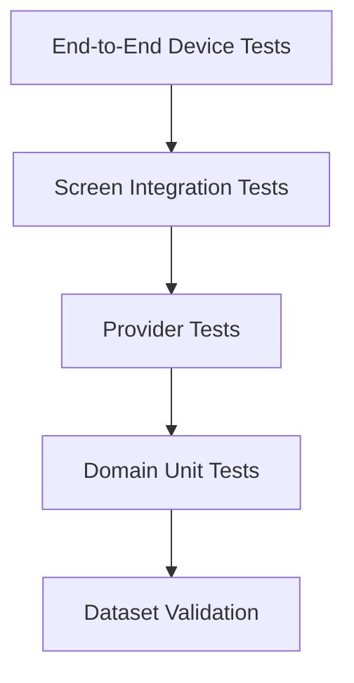

## 19.9 Recommended additional tests

### Element data

- Exactly 118 identity records.
- No duplicate atomic numbers.
- No duplicate symbols.
- Valid names and symbols.
- Valid block and period values.
- Appropriate group representation.
- Scientific verification metadata.

### Discovery

- Valid element discovery.
- Duplicate swipe prevention.
- Like and pass behavior.
- Collection updates.
- Progress persistence.

### Chemistry

- Correct formula validation.
- Incorrect formula validation.
- Atom-order independence.
- Stoichiometric ratios.
- Empty selection.
- Duplicate elements.
- Unknown atomic numbers.
- Unsupported combinations.

### Memory

- Correct-answer scheduling.
- Incorrect-answer retry.
- Independent skill tracking.
- Review queue selection.
- Date rollover.

### Gamification

- XP calculations.
- Quest progress.
- Reward claims.
- Duplicate claim prevention.
- Insufficient wallet balance.
- Inventory updates.
- Streak behavior.
- State migrations.

### UI

- iOS rendering.
- Android rendering.
- Web responsiveness.
- Accessibility.
- Reduced motion.
- Empty states.
- Error states.
- Offline startup.

## 19.10 Release readiness checklist

- [ ] Confirm app icon and splash screen.
- [ ] Confirm bundle identifiers.
- [ ] Verify all element identity records.
- [ ] Review educational content.
- [ ] Complete character artwork.
- [ ] Integrate gamification events.
- [ ] Verify reward calculations.
- [ ] Add persistence recovery tests.
- [ ] Test on physical iOS devices.
- [ ] Test on physical Android devices.
- [ ] Verify screen-reader accessibility.
- [ ] Verify reduced-motion behavior.
- [ ] Review privacy disclosures.
- [ ] Test offline behavior.
- [ ] Prepare App Store and Google Play assets.

---

# 20. Roadmap and Future Development

## Phase 1 — Core foundation

**Objective:** Stabilize the basic game.

- Complete discovery interactions.
- Improve card transitions.
- Improve element profile pages.
- Add collection filters.
- Improve periodic-table visualization.
- Validate all 118 element identities.
- Improve loading and error states.
- Expand automated tests.

## Phase 2 — Educational expansion

**Objective:** Make the learning experience deeper.

- Expand element explanations.
- Add periodic-family lessons.
- Add periodic trends.
- Add atomic structure learning.
- Improve memory challenges.
- Add independent mastery tracking.
- Add periodic-table reconstruction.
- Expand curated chemistry scenarios.

## Phase 3 — Gamification integration

**Objective:** Connect gameplay to progression.

- Wire discovery events.
- Wire quiz events.
- Wire formula-building events.
- Connect quests to gameplay.
- Connect badges to real achievements.
- Prevent duplicate rewards.
- Add progression summaries.
- Improve quest navigation.
- Test reward transactions.

## Phase 4 — Character universe

**Objective:** Expand the personality-driven experience.

- Original character artwork for all elements.
- Unique character profiles.
- Character dialogue.
- Family-based collections.
- Character story unlocks.
- Alternative card frames.
- Seasonal character themes.
- Collection milestones.

## Phase 5 — Advanced chemistry learning

**Objective:** Introduce deeper scientific concepts.

- Electron configurations.
- Valence electrons.
- Periodic trends.
- Ionic bonding.
- Covalent bonding.
- Molecular geometry.
- Chemical nomenclature.
- Stoichiometry.
- Chemical equations.
- Material properties.

## Phase 6 — AI learning assistant

**Objective:** Introduce personalized educational assistance.

- AI Chemistry Tutor.
- Approved scientific retrieval.
- Adaptive question generation.
- Personalized learning recommendations.
- Explanation difficulty adjustment.
- Weak-topic identification.
- Guided study sessions.

AI should remain grounded in approved chemistry content.

## Phase 7 — Mobile release

**Objective:** Prepare the product for public distribution.

- iOS performance optimization.
- Android performance optimization.
- App Store screenshots.
- Google Play screenshots.
- Privacy review.
- Accessibility review.
- Crash recovery.
- Device testing.
- Localization.
- Production content verification.

---

# Technical Design Summary

| System | Current foundation |
|---|---|
| Mobile framework | Expo / React Native |
| Language | TypeScript |
| Navigation | Expo Router |
| Element dataset | JSON |
| Chemistry scenarios | TypeScript data |
| Discovery | Local deterministic engine |
| Player state | React Context |
| Gamification state | Separate provider |
| Persistence | AsyncStorage |
| Learning review | Skill-level scheduling |
| Formula validation | Curated scenario matching |
| AI tutor | Future development |
| Cloud sync | Future development |
| Multiplayer | Future development |

# Current Implementation Boundaries

This repository is a development foundation. The following distinctions are important:

| Capability | Status |
|---|---|
| 118 element identity records | Present; full scientific review remains necessary |
| Element character data model | Present |
| Discover screen | Present |
| Matches screen | Present |
| Memory screen | Present |
| Chemistry Lab screen | Present |
| Periodic World screen | Present |
| Progress screen | Present |
| Local player persistence | Present |
| Basic review scheduling | Present |
| Curated formula validation | Present |
| Gamification provider | Present |
| Gamification routes | Present |
| Full gameplay-to-gamification event integration | Follow-up work |
| Fully reviewed biographies for every element | Not claimed |
| General chemical reaction prediction | Not implemented |
| AI Chemistry Tutor | Future development |
| Cloud synchronization | Future development |
| Multiplayer | Future development |
| Teacher dashboard | Future development |
| Complete production character artwork | Not included in the foundation |
| App Store release certification | Not claimed |

# Contributing

Contributions are welcome.

Recommended contribution workflow:

1. Identify a scientific, educational or gameplay improvement.
2. Open an issue describing the proposed change.
3. Identify the relevant application layer.
4. Update the implementation.
5. Add tests for new behavior.
6. Update documentation.
7. Run type checking.
8. Run relevant tests.
9. Submit a focused pull request.

### Contribution guidelines

- Preserve scientific accuracy.
- Keep element identity centralized.
- Avoid hardcoding domain rules inside UI components.
- Separate fictional social mechanics from chemistry.
- Do not invent scientific properties.
- Add tests for new domain behavior.
- Avoid duplicate reward events.
- Keep accessibility in mind.
- Document incomplete or experimental functionality.

# License and Attribution

Add the project's selected software license before public distribution.

Fonts, icons, artwork, music, sound effects and other external assets should have their licenses recorded separately.

Scientific information should be reviewed and attributed through the content-governance workflow.

---

<p align="center">

# CHEMICAL ROMANCE 💘🧪

**118 Elements. Infinite Personality. Real Chemistry.**

*Discover the elements. Remember the science. Build your chemistry.*

</p>
